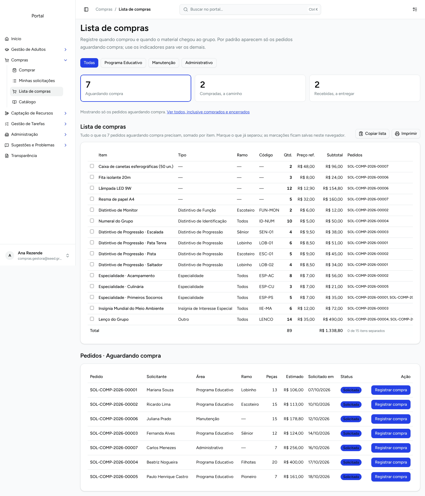
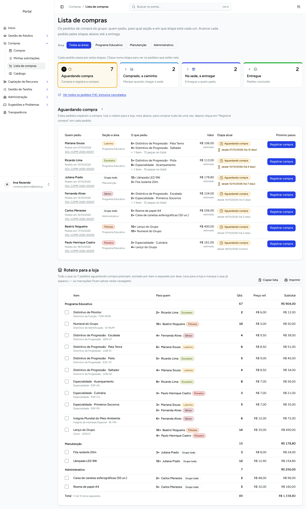
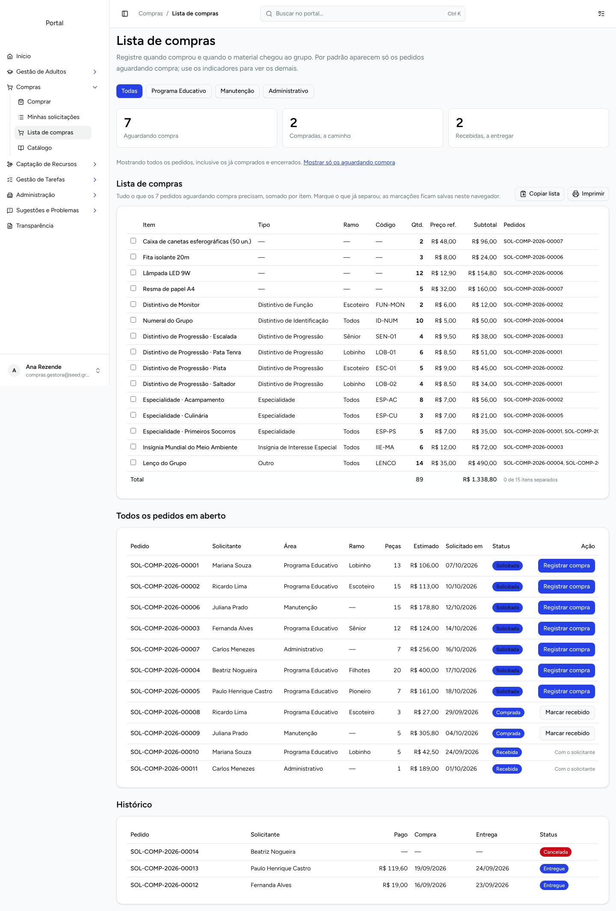
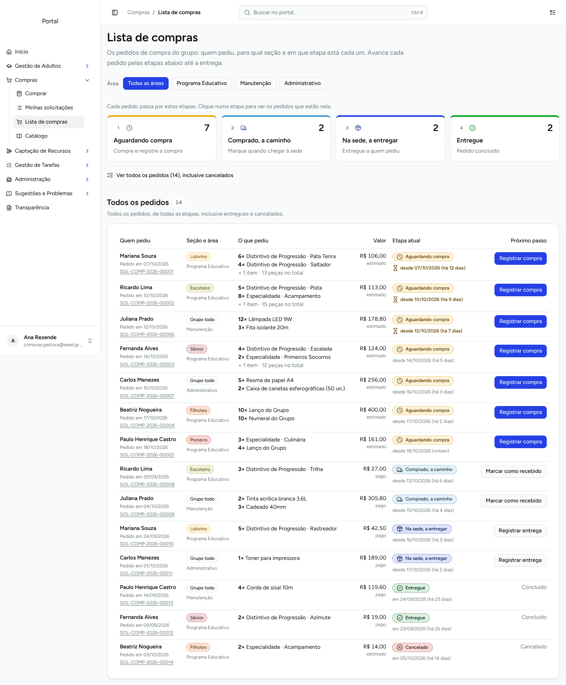
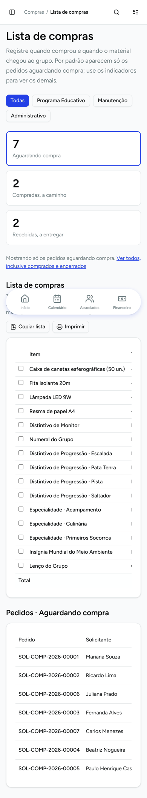
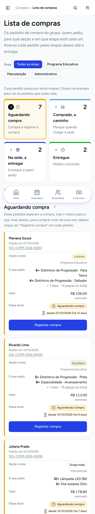

# Lista de compras (`/compras/fila`) — crítica de design e refatoração

Prints gerados num site local com o seed de Compras
(`bench --site <site> execute gris.scripts.seed.main.seed_test_data --kwargs '{"only":["compras"]}'`),
vistos como `compras.gestora@seed.gris.local` (gestora das três áreas) e
`helena.ramos@seed.gris.local` (Gestor Financeiro, só acompanha).

## Contexto

- **Quem usa:** o gestor de cada área (compra, recebe, entrega) e o financeiro (acompanha).
  Uso recorrente, rápido, muitas vezes no celular, na loja.
- **O que precisa saber:** como usar a tela, em que etapa está cada pedido, quem pediu e para qual seção.

## Achados da avaliação heurística (antes)

| # | Problema | Princípio | Severidade |
|---|---|---|---|
| 1 | Os selos de status têm a mesma cor (azul) para Solicitada, Comprada, Recebida e Entregue: não dá para distinguir a etapa de relance. | H1 Visibilidade do estado · cor como único sinal | 3 |
| 2 | O mesmo estado tem três nomes: indicador "Aguardando compra", selo "Solicitada", filtro “Solicitada”. | H4 Consistência · H2 Linguagem do usuário | 3 |
| 3 | O fluxo do pedido (pedido → compra → chegada à sede → entrega) não é explicado em lugar nenhum; o subtítulo é um parágrafo denso sobre filtros. | H10 Ajuda · Paradoxo do usuário ativo | 3 |
| 4 | A tabela consolidada (15 linhas) vem antes dos pedidos: quem pediu e o botão de ação ficam abaixo da dobra. | Hierarquia visual · Posição serial | 3 |
| 5 | A seção aparece como texto cinza na coluna "Ramo" e "—" fora do PE; na lista consolidada, cada item aponta para códigos `SOL-COMP-2026-00001`, que a pessoa precisa decorar para saber para quem é. | H6 Reconhecer em vez de lembrar | 3 |
| 6 | Os indicadores funcionam como filtro mas não parecem clicáveis; "Entregues" só aparece em "Ver todos"; o filtro ativo é descrito numa frase. | Affordance · Lei de Jakob | 2 |
| 7 | Só a data do pedido: não se vê há quanto tempo ele está parado na etapa atual. | H1 · Efeito Zeigarnik | 2 |
| 8 | No celular as tabelas cortam: só "Pedido" e "Solicitante" ficam visíveis; status e ação somem para a direita. | Responsividade · Lei de Fitts | 3 |
| 9 | Pedido "Recebida" mostra "Com o solicitante", embora o gestor também possa registrar a entrega — não há como fazê-lo daqui. | Excise de navegação | 2 |
| 10 | O diálogo de compra mostra só o código do pedido: nada confirma que é o pedido da pessoa certa. | H5 Prevenção de erro | 2 |

## O que mudou (depois)

- **Etapas numeradas como navegação** (1 Aguardando compra → 2 Comprado, a caminho → 3 Na sede, a entregar → 4 Entregue),
  com contagem, ícone, cor própria e uma dica do que fazer em cada uma. É, ao mesmo tempo, o "como funciona" e o filtro.
  "Ver todos os pedidos" inclui os cancelados. (achados 3, 6)
- **Selo de etapa com cor + ícone + texto**, usando os tokens `--warning`, `--info`, `--primary`, `--success` e `--destructive`
  do tema; o mesmo vocabulário nas abas, no selo e no título da seção. (1, 2)
- **Pedidos primeiro, roteiro para a loja depois.** Cada pedido mostra quem pediu, a seção com a cor oficial do ramo
  (ou "Grupo todo" fora do PE), a área, o que pediu (`6× Pata Tenra…`), o valor (estimado ou pago),
  a etapa e **desde quando** está nela — com destaque para quem está parado há 7 dias ou mais. (4, 5, 7)
- **Coluna "Próximo passo"**: o botão da etapa seguinte para quem compra (Registrar compra / Marcar como recebido /
  **Registrar entrega**, novo); para quem só acompanha, com quem está o pedido. Aviso explícito no topo para o financeiro. (9)
- **Roteiro para a loja** separado por área, com "Para quem" em cada item (`3× Mariana Souza · Lobinho`) no lugar dos códigos. (5)
- **Diálogos** repetem pedido, pessoa e seção antes de confirmar. (10)
- **Celular:** pedidos e itens viram cartões com rótulo em cada campo; o botão ocupa a largura toda (44 px). (8)

## Evidências

| Antes | Depois |
|---|---|
|  |  |
|  |  |
|  |  |

Extras: [na sede, visão do gestor](06-depois-na-sede-gestor.png) ·
[na sede, visão do financeiro](07-depois-na-sede-financeiro.png) ·
[diálogo de compra](08-depois-dialogo-compra.png).
